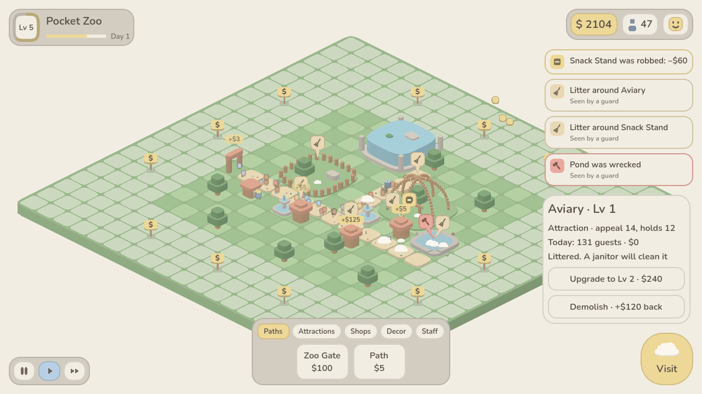
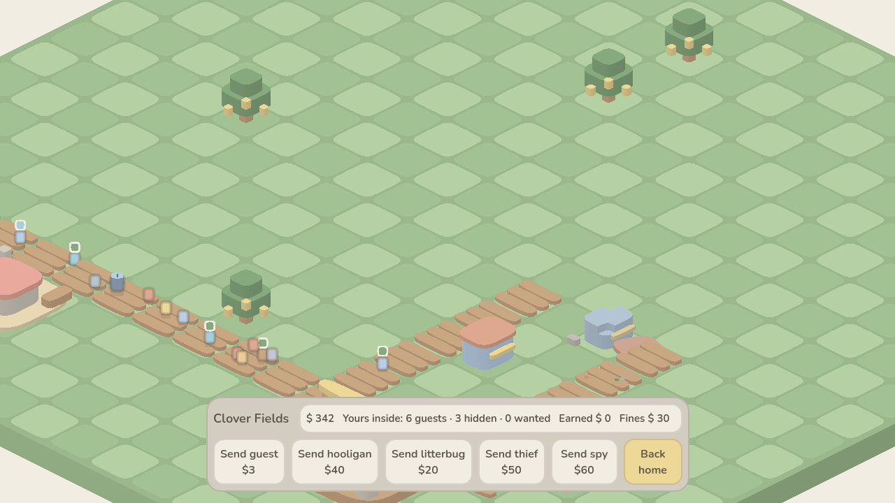
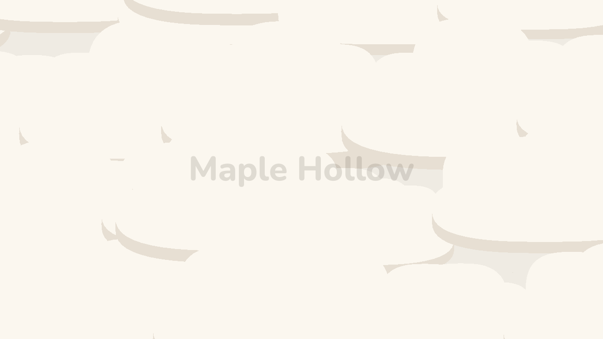
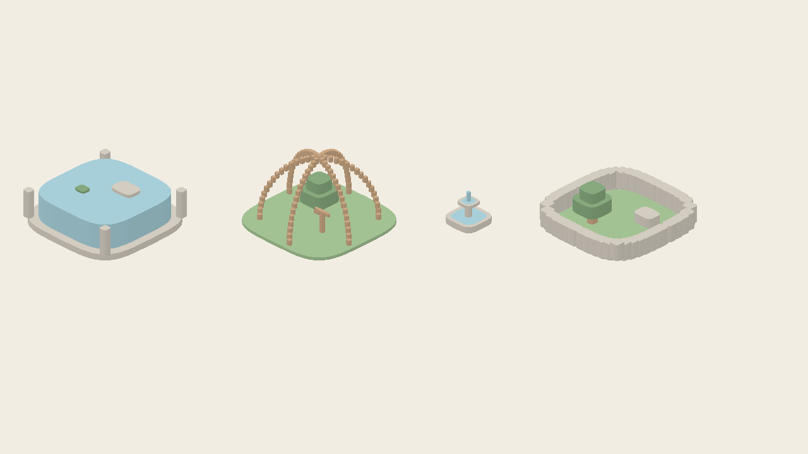

<div align="center">

# 🌿 Pocket Parks

**A cosy isometric park builder where your friends' guests aren't always who they seem.**

Build a small park, keep your guests happy, and visit friends to send people in:
honest visitors who spend money there, and *bad actors* who blend into the crowd,
strike, hide again, and press their luck.

[**⬇ Download**](https://github.com/MKrabs/pocket-parks/releases/latest) ·
[How to play](#-how-to-play) ·
[Build from source](#-build-from-source)



</div>

---

## ✨ What's in it

| | |
|---|---|
| 🏗 **Build** | Paths, attractions, shops and decor on an isometric grid. Rotate with <kbd>R</kbd>, upgrade buildings to level 3, buy more land as your park grows. |
| 👷 **Builders** | Every job needs a builder from a builder shed. Give each one a specialty (Water, Aviary, Landscaper, Heavy, Carpenter, Projection) to build faster, or to unlock specialist-only buildings like the water tank or the aviary. |
| 🎭 **Themes** | Zoo, food festival, cinema, amusement park and conference. Each one is a data pack, so more can follow. |
| 🦦 **Habitats and animals** | Paint habitats in any shape with a wood fence, glass, a net dome or a stone wall, then pick from 9 animals (otters, red pandas, shoebills…). Each animal has needs, and you decorate with pools, rocks, trees, shelters and waterfalls until it's happy. |
| 🌸 **Park charm** | Guests rate the *walk* between stops. Lovely strolls make them happier and spend more, rows of the same stand make paths dull. Press <kbd>C</kbd> to see it. |
| 🕵️ **Sending people** | Visit a park and send in guests (you earn a share of what they spend) or hooligans, litterbugs, thieves and spies. They stay hidden until they strike. |
| 🛡 **Defending** | Crime reports tell you *what* and *where*, never *who*. Guards catch what they witness; you can accuse anyone, but a wrongful arrest costs *you*. |
| 🌐 **Play with friends** | Parks on the same network find each other. Visit a friend's park live, no server or account needed. |
| ☁️ **Soft and readable** | Pastel colours, rounded shapes, and a cloud transition between parks. |

<p align="center">
  
  
</p>

## ⬇ Install

Grab the latest build from the [**Releases page**](https://github.com/MKrabs/pocket-parks/releases/latest).

### macOS (Apple Silicon and Intel)

1. Download `PocketParks-macos.zip` and unzip it.
2. **Right-click** `Pocket Parks.app` → **Open** → **Open**.
   The app isn't notarised by Apple, so a plain double-click shows a warning the first time.
   If macOS still refuses, run this once in Terminal:
   ```bash
   xattr -dr com.apple.quarantine "Pocket Parks.app"
   ```
3. When macOS asks to **allow incoming network connections**, click **Allow**, so friends can visit your park.

### Linux (x86_64)

```bash
chmod +x PocketParks.x86_64
./PocketParks.x86_64
```

### Playing with a friend

Both of you start the game on the **same network** (the same Wi-Fi, or a shared [Tailscale](https://tailscale.com) network).
Click **Visit**, and your friend's park shows up under *Nearby*. You both need the **same version** of the game.

## 🎮 How to play

| Action | How |
|---|---|
| Select a building or person | Left-click |
| Build | Pick an item in the bottom bar, click the grid |
| Cancel building | <kbd>Esc</kbd>, right-click, or click the item again |
| Keep placing | Hold <kbd>Shift</kbd> |
| Rotate | <kbd>R</kbd> / <kbd>Shift</kbd>+<kbd>R</kbd> |
| Pan | Middle-drag, <kbd>W</kbd><kbd>A</kbd><kbd>S</kbd><kbd>D</kbd>, or a two-finger swipe |
| Zoom | Mouse wheel, <kbd>Ctrl</kbd>+wheel, or pinch |
| Switch theme | <kbd>T</kbd> |
| Charm view | <kbd>C</kbd> |
| Show or hide the build bar | <kbd>B</kbd> |
| Talk | <kbd>Enter</kbd> |
| New park | <kbd>F9</kbd> |

Your park saves itself every 30 seconds and when you quit.

<p align="center">
  
</p>

## 🛠 Build from source

Pocket Parks is made with [**Godot 4.6.2**](https://godotengine.org/download/archive/4.6.2-stable/) in GDScript. It has no plugins or other dependencies.

```bash
git clone https://github.com/MKrabs/pocket-parks.git
cd pocket-parks
export GODOT=/path/to/Godot_v4.6.2-stable   # optional, defaults to ~/Downloads/Godot_v4.6.2-stable_linux.x86_64
./gd run       # play
./gd check     # run every test headless
./gd edit      # open the Godot editor
./gd export    # builds/PocketParks-macos.zip + builds/PocketParks.x86_64
```

`./gd export` needs the matching [export templates](https://godotengine.org/download/archive/4.6.2-stable/)
installed (Godot editor → *Editor → Manage Export Templates*).

## 🤖 How it's made

Almost all of the code was written by Claude Code agents working from tickets. A small "factory" hands each ticket to a
worker in its own git worktree, and the worker checks its result with headless tests and offscreen screenshots.
A human plays it, decides what's next, and approves each merge.

| Where | What |
|---|---|
| [`docs/design/game.md`](docs/design/game.md) | The game design: what's decided, the defaults, the roadmap |
| [`tickets/`](tickets) | Every ticket, with the worker's handoff notes |
| [`CLAUDE.md`](CLAUDE.md) | The rules the agents follow |
| `factory`, `tix`, `wall` | The dispatcher, the ticket queue and the tmux view |

## Credits

- Font: [Nunito](https://github.com/googlefonts/nunito) by The Nunito Project Authors, [SIL Open Font License 1.1](assets/fonts/OFL.txt)
- Engine: [Godot Engine](https://godotengine.org) (MIT)
